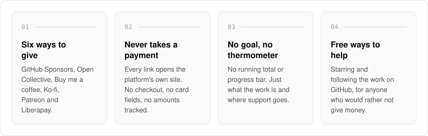
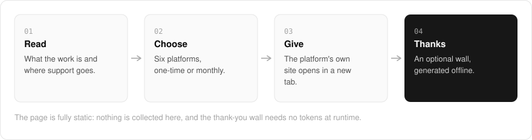

  <picture>
    <source media="(prefers-color-scheme: dark)" srcset=".github/assets/hero-dark.png">
    
  </picture>

<h1 align="center">support.me.at</h1>

<strong>It is all free to use. Sponsors are how it stays maintained.</strong>

  
  
  

  <a href="https://support.me.at">Website</a> ·
  <a href="#features">Features</a> ·
  <a href="#how-it-works">How it works</a> ·
  <a href="#built-with">Built with</a>

Donate pages tend to push: goal bars, running totals, a card form on the page. I built support.me.at as a small, static sponsor hub for my work: open-source libraries, the me.at apps, and the notes around them. It says what the work is and where support goes, then points to the funding platforms people already use. Nothing is collected on the page itself, every link opens the platform's own site, and there is deliberately no goal, running total or thermometer.

  <picture>
    <source media="(prefers-color-scheme: dark)" srcset=".github/assets/overview-dark.svg">
    
  </picture>

## Why support.me.at

| The usual donate page | support.me.at |
| --- | --- |
| A goal bar and a running total | No goal, total or thermometer |
| A card form on the page | Links out only; nothing is collected here |
| One platform | Six platforms, labelled one-time or monthly |
| Money is the only way to help | Free ways to help, listed alongside |

## Features

- **Six funding platforms**: GitHub Sponsors, Open Collective, Buy me a coffee, Ko-fi, Patreon and Liberapay, each labelled with whether it is one-time or monthly.
- **Where it goes**: three short lines on what support pays for, from open-source maintenance to keeping the me.at apps running and free.
- **Free ways to help**: starring and following the work on GitHub, for people who would rather not give money.
- **Sponsor acknowledgement wall**: an optional static thank-you wall, generated offline from a local payload with no tokens at runtime.
- **Never takes a payment**: the page only links out; no checkout, no card fields, no tracking of amounts.
- **Accessible by design**: every outbound card carries an explicit accessible name that discloses it opens in a new tab.

## How it works

  <picture>
    <source media="(prefers-color-scheme: dark)" srcset=".github/assets/flow-dark.svg">
    
  </picture>

The page is one fully static route, with its copy and link data validated by Zod. It says what the work is and where support goes, then lists six platforms labelled one-time or monthly, and every card opens the platform's own site in a new tab. The optional thank-you wall is generated offline from a local payload, so it needs no tokens at runtime.

## Built with

  
  
  
  
  

- Next.js 16 (App Router), React 19, TypeScript
- Tailwind CSS 4
- Zod for validating the page's copy and link data
- Fully static, one route

## Part of the me.at family

support.me.at is one of my [`*.me.at`](https://me.at) apps. They share one design system, account, and app shell. Development happens in a private monorepo; this repository is the project's public-facing home.

## License

Source-available. See [LICENSE](LICENSE).
