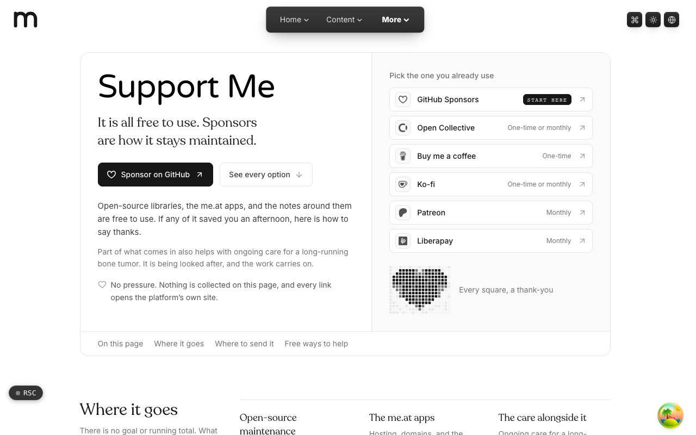

  <picture>
    <source media="(prefers-color-scheme: dark)" srcset=".github/assets/hero-dark.png">
    
  </picture>

# support.me.at

It is all free to use. Sponsors are how it stays maintained.

support.me.at is a small, static sponsor and donate hub for Trevor McDougald's work: open-source libraries, the me.at apps, and the notes around them. It says what the work is and where support goes, then points to the funding platforms people already use. Nothing is collected on the page itself, every link opens the platform's own site, and there is deliberately no goal, running total or thermometer.

**Live:** [support.me.at](https://support.me.at)

## Features

- **Six funding platforms**: GitHub Sponsors, Open Collective, Buy me a coffee, Ko-fi, Patreon and Liberapay, each labelled with whether it is one-time or monthly.
- **Where it goes**: three short lines on what support pays for, from open-source maintenance to keeping the me.at apps running and free.
- **Free ways to help**: starring and following the work on GitHub, for people who would rather not give money.
- **Sponsor acknowledgement wall**: an optional static thank-you wall, generated offline from a local payload with no tokens at runtime.
- **Never takes a payment**: the page only links out; no checkout, no card fields, no tracking of amounts.
- **Accessible by design**: every outbound card carries an explicit accessible name that discloses it opens in a new tab.

## Built with

- Next.js 16 (App Router), React 19, TypeScript
- Tailwind CSS 4
- Zod for validating the page's copy and link data
- Fully static, one route

## Part of the me.at family

support.me.at is one of the [`*.me.at`](https://me.at) apps by Trevor McDougald. They share one design system, account, and app shell. Development happens in a private monorepo; this repository is the project's public-facing home.

## License

See [LICENSE](LICENSE).
